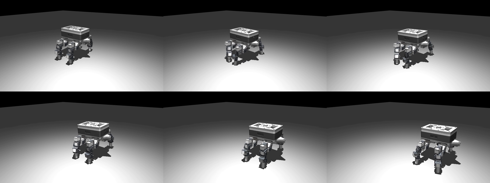
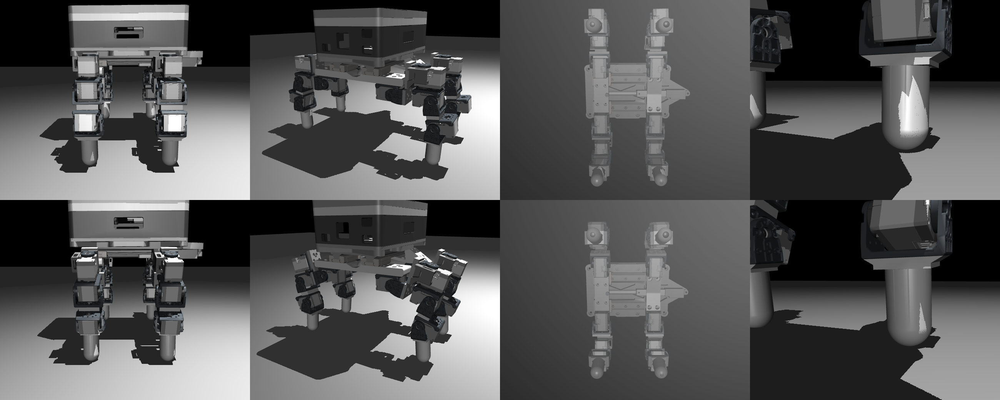

# hand-loco-v2

Making a dexterous robotic hand **walk on its four fingertips** in MuJoCo.



This is the second iteration of the project. The hand is a 16-DOF tendon-free finger
assembly exported from CAD as `model/full_hand_final/robot.urdf`. Instead of grasping,
four fingers are used as legs and the whole hand becomes a tiny quadruped.

## Highlights

- Compiles the CAD URDF into a **free-base MuJoCo model** for locomotion, keeping only the
  four fingertips collidable (MuJoCo inflates concave CAD meshes to their convex hull,
  so all-part collision produced ~600 spurious contacts and the palm rested on the floor).
- A **standing stance** (`stance1`) where the second servo `MCP-ABD` stands upright with
  its rotation axis vertical `(0, 0, 1)`. All four fingertips splay out over a 229 mm
  footprint and touch the ground vertically.
- A **2&2 diagonal trot**: pairs `A+D` and `B+C` alternate. The gait is driven by nothing
  but the `MCP-ABD` steering servo sweeping left and right.
- A per-leg **IK table** keeps each fingertip pinned at its stance `(y, z)`, so the foot
  does not scrape along the floor while the trunk translates forward.
- Walks **+302 mm in 10 s (30 mm/s)** along `+x` with `trunk z = 204.6 mm`,
  `yaw = -4.2 deg`, and the fingertips still visible above the floor.

## Result

The table below preserves the original reported result. The corrected yaw
calculation and fresh CPU reproduction are documented in
[REPRODUCTION.md](REPRODUCTION.md); the original yaw figure is not comparable.



| Metric | Value |
| --- | --- |
| Travel (+x) | +302 mm / 10 s (30 mm/s) |
| Lateral drift (y) | -2.5 mm |
| Yaw | -4.2 deg |
| Trunk height | 204.6 mm (free stance 210 mm) |
| Fingertip penetration | ~7 mm |

Videos: `figures/walk_x.mp4` (final gait), `figures/walk.mp4` (earlier gait).

## Layout

```
tools/build_model.py   compile URDF -> model/quadruped_sim_v2.xml (+ keyframes, --check)
tools/stance.py        report / render the two standing poses
tools/walk.py          earlier gait
tools/walk_x.py        the 2&2 fingertip trot along +x  <- main entry point
model/full_hand_final/ CAD export (URDF + STL meshes)
model/quadruped_sim_v2.xml  generated MuJoCo model
figures/               renders and videos
```

## Setup

The verified environment uses Python 3.11.17 and MuJoCo 3.17.0; see
[REPRODUCTION.md](REPRODUCTION.md) for CPU rendering and measured results.

```bash
pip install -r requirements.txt
```

Offscreen rendering needs EGL on headless Linux:

```bash
export MUJOCO_GL=egl
```

## Usage

Build the MuJoCo model from the URDF and verify both standing keyframes hold for 5 s each:

```bash
python tools/build_model.py --check
```

Report the two standing poses and render them:

```bash
python tools/stance.py
```

Run the walking gait (10 s, prints travel / drift / yaw / height):

```bash
python tools/walk_x.py 10
```

Record a new video without overwriting the shipped reference video:

```bash
MUJOCO_GL=egl python tools/walk_x.py 10 --render \
  --output outputs/walk_new.mp4 --report outputs/walk_new.json
```

## How the gait works

`stance1` puts `MCP-FLX` at 90 deg, which makes the `MCP-ABD` axis vertical. Rotating
`MCP-ABD` therefore sweeps the whole leg through the horizontal plane at constant height.
Measured with the fingertip at its stance `(y, z)`:

| Legs | Stance sweep | Fingertip motion | Trunk push |
| --- | --- | --- | --- |
| A, B | `abd` HI -> LO | 37 mm backwards | +x |
| C, D | `abd` LO -> HI | 38 mm backwards | +x |

Diagonal pairs `A+D` and `B+C` share the same push direction, so the hand trots instead of
yawing. While a pair is in stance the other pair lifts (`MCP-FLX` +0.16 rad) and carries
forward.

## Notes on friction

Large friction does not inherently make the fingertips sink. The chain is: high friction ->
large tangential force -> the friction cone demands a larger normal force -> the elastic
contact compresses further into the floor. The fix is not to lower friction but to make the
contact stiff:

- `TIP_FRICTION = "10.0 0.05 0.01"` on the fingertips, `1.8 0.05 0.01` on the floor
- fingertip geoms use `condim="4" solref="0.0005 1" solimp="0.999 0.9999 0.0001"`

Together this keeps the penetration near 7 mm instead of 42 mm, so the fingers stay visible.

## XC330 hardware interface preparation

The simulation now has an optional position-command interface matching the
confirmed motor IDs 0–15 and the reference 50 Hz command / 20 Hz feedback cadence.
See [HARDWARE_INTERFACE.md](HARDWARE_INTERFACE.md) for the mapping, CPU command,
validation and remaining hardware-calibration requirements. This is simulation
interface validation; no physical robot connection or deployment is implemented.
